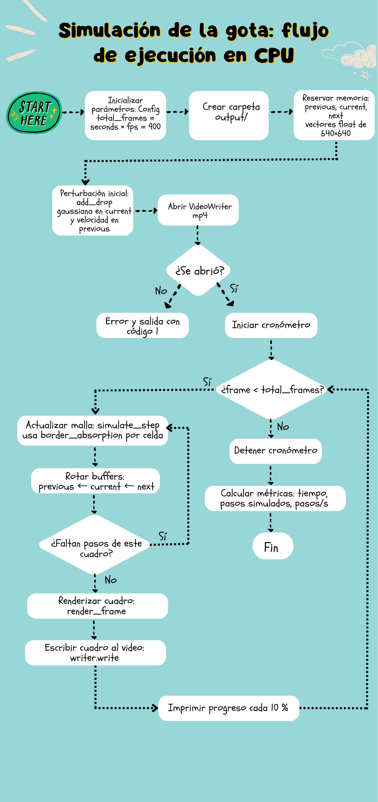
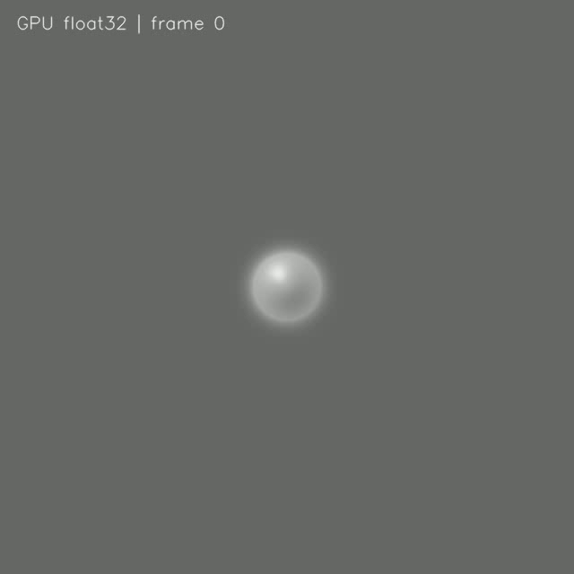
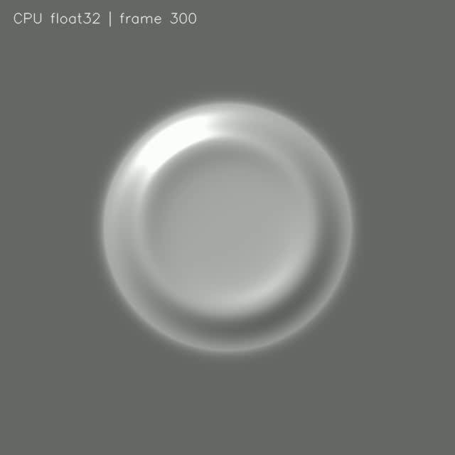
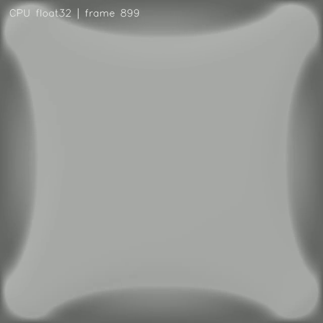

# Cap_3_Lab
Laboratorio del Capítulo 3

# Reporte: Laboratorio 5, Computación Heterogénea y GPU

EL5859 Computación Heterogénea, II Semestre 2026.
Integrantes: Gonzalo Alpízar Salas, Gerson Adrián Cordero Zúñiga, Nicole Irina Corrales Rodríguez, Keilin Loáisiga Téllez

## Contenido

1. [Descripción del programa base](#1-descripción-del-programa-base)
2. [Diagrama de flujo](#2-diagrama-de-flujo)
3. [Explicación de cada función](#3-explicación-de-cada-función)
4. [Resultados del perfilado CPU](#4-resultados-del-perfilado-cpu)
5. [Justificación de las funciones portadas a GPU](#5-justificación-de-las-funciones-portadas-a-gpu)
6. [Diseño de los kernels CUDA](#6-diseño-de-los-kernels-cuda)
7. [Estrategia de validación CPU vs GPU](#7-estrategia-de-validación-cpu-vs-gpu)
8. [Resultados de cada optimización](#8-resultados-de-cada-optimización)
9. [Capturas de Nsight / nvprof](#9-capturas-de-nsight--nvprof)
10. [Análisis de rendimiento](#10-análisis-de-rendimiento)
11. [Conclusiones](#11-conclusiones)
12. [Instrucciones de compilación y ejecución](#12-instrucciones-de-compilación-y-ejecución)
13. [Declaración de uso de IA](#13-declaración-de-uso-de-ia)

---

## 1. Descripción del programa base

El programa simula la caída de una gota sobre un estanque y genera un video de 30 s
en escala de grises. La superficie del agua es una malla de 640 × 640 alturas
(`float`). En cada paso de tiempo se calcula cómo cambia la altura de cada celda a
partir de sus vecinas y de su movimiento anterior. Después cada estado se dibuja
con iluminación simple para que parezca agua y se escribe como un cuadro del video.

### Modelo físico

Lo que se aproxima es la **ecuación de onda 2D amortiguada**:

```
∂²h/∂t² = c² ∇²h − γ ∂h/∂t
```

- `h(x, y, t)` es la altura del agua.
- `c` (`wave_speed` = 0.45) es la velocidad con la que viaja la onda.
- `γ` (`damping`) es la pérdida de energía, que hace que las ondas se vayan apagando.

Se resuelve con diferencias finitas explícitas (esquema tipo Verlet), tomando
`dt = dx = 1`:

```
laplaciano = izquierda + derecha + arriba + abajo − 4·centro
h_next = 2·h_cur − h_prev + c²·laplaciano − amortiguamiento·(h_cur − h_prev)
```

La condición inicial es una gaussiana de radio 18 celdas en el centro del estanque,
con una velocidad inicial para que la onda salga hacia afuera. En los bordes hay una
capa absorbente de 32 píxeles que aumenta el amortiguamiento para que las olas no
reboten contra el marco. Para que el esquema sea estable en 2D se necesita
`c ≤ 1/√2 ≈ 0.707`, y con `c = 0.45` se cumple.

### Línea base CPU (Ejercicio A)

| Métrica | Valor |
|---|---|
| Resolución | 640 × 640 px |
| Duración del video | 30 s |
| FPS | 30 |
| Pasos simulados | 900 (1 paso por cuadro) |
| Tiempo total (promedio de 4 corridas) | 13.29 s (σ ≈ 0.05 s) |
| Rendimiento (promedio) | 67.7 pasos/s |
| Uso de CPU | 99 % (un solo hilo) |
| Memoria máxima | ≈ 73 MB |
| Entorno | x86_64, gcc 13.3.0, Meson 1.3.2, OpenCV 4.6.0, `--buildtype=release` |

Las 4 corridas dieron 13.367, 13.283, 13.263 y 13.257 s. La primera fue la más lenta,
posiblemente porque el sistema aún no tenía el programa en caché. El tiempo medido
por el programa incluye la simulación, el renderizado y la escritura del video, pero
no la reserva de memoria ni `add_drop`. Esta medición se hizo en una PC x86_64. Los speedups de la GPU se calculan contra la CPU de la Jetson Nano (sección 4), porque es el mismo hardware en el que corre la GPU.

## 2. Diagrama de flujo
   
   

## 3. Explicación de cada función

El código fuente comentado está en [`src/main.cpp`](src/main.cpp).


**`Config`**: es una estructura donde están todos los parámetros juntos (tamaño de la malla, duración, fps, las constantes de la física, el tamaño de la gota y el nombre del video). Se crea una vez en `main` y las demás funciones la reciben, así si queremos cambiar algo lo hacemos en un solo lugar.

**`index_of`**: pasa una posición `(x, y)` al índice del vector, porque la malla se guarda como un solo arreglo, fila por fila.

**`add_drop`**: pone la gota al inicio, le suma una campana (gaussiana) al centro de `current` y le resta una parte a `previous`. como la velocidad sale de `current − previous`, la gota empieza con velocidad y por eso la onda sale hacia afuera. Solo se corre una vez, antes del ciclo.

**`border_absorption`**: dice cuánto amortiguamiento le toca a cada celda según qué tan cerca está del borde. En el centro es el valor base, y en los 32 píxeles del borde aumenta poco a poco, así las olas se van apagando antes de llegar al marco y no rebotan.

**`simulate_step`**: avanza la simulación un paso, para cada celda toma sus 4 vecinas, calcula el laplaciano y con eso saca el valor nuevo en `next`, restando el amortiguamiento por la velocidad. Cada celda solo lee valores del paso anterior, entonces todas se pueden calcular al mismo tiempo (esto es lo que nos sirve para GPU), el borde queda en 0.

**`render_frame`**: convierte las alturas en una imagen, para cada píxel mira los vecinos para ver qué tan inclinada está la superficie, de ahí saca la luz que recibe y un brillo en las crestas, y lo mezcla con la altura para decidir el gris. También escribe el número de cuadro encima. Cada píxel es independiente de los demás.

**`main`**: reserva las tres mallas (`previous`, `current` y `next`), pone la gota, abre el video y corre el ciclo. En cada cuadro hace la simulación, dibuja y escribe el cuadro al video. Al final calcula el tiempo y los pasos por segundo.

## 4. Resultados del perfilado CPU

Para identificar las funciones críticas del programa antes de realizar el
porteo a CUDA, se efectuó un perfilado de la versión CPU en una NVIDIA
Jetson Nano.

Se utilizaron dos herramientas: `perf` para identificar las operaciones
con mayor consumo de CPU y `std::chrono` para medir individualmente los
tiempos de ejecución de las funciones principales.

### 4.1. Entorno de ejecución

Las mediciones se realizaron con la siguiente configuración:

| Componente | Especificación |
|---|---|
| Plataforma | NVIDIA Jetson Nano |
| Arquitectura CPU | ARM Cortex-A57 (aarch64) |
| Sistema operativo | Ubuntu 18.04 / NVIDIA L4T R32.7.1 |
| Kernel Linux | 4.9.253-tegra |
| Compilador | GCC 7.5.0 |
| CUDA Toolkit | 10.2 |
| OpenCV | 4.1.1 |
| Resolución | 640 × 640 píxeles |
| Fotogramas | 900 |
| Pasos de simulación | 900 |

Se mantuvieron los parámetros originales de la simulación para obtener
mediciones representativas del comportamiento del programa base.

### 4.2. Perfilado mediante perf

Se utilizó `perf` para identificar las funciones y operaciones que
concentraban la mayor cantidad de muestras de CPU durante la ejecución.

El perfilado se realizó mediante el comando:

```bash
sudo /usr/lib/linux-tools-4.15.0-213/perf record \
-e cpu-clock -F 99 -g \
-o perf_cpu.data -- ./build/drop_simulation
```

Posteriormente, se obtuvo el reporte mediante:

```bash
sudo /usr/lib/linux-tools-4.15.0-213/perf report \
-i perf_cpu.data --stdio --no-children
```

El perfilado recopiló aproximadamente 10 000 muestras sin pérdidas.

Los resultados más relevantes fueron:

| Función o símbolo | Porcentaje de muestras |
|---|---:|
| `main` | 53.01 % |
| `powf` | 29.36 % |
| `libavcodec` (símbolo principal reportado) | 7.76 % |
| `libswscale` (símbolo principal reportado) | 2.60 % |

El resultado de `powf` es especialmente importante, ya que esta función
se utiliza en `render_frame()` para calcular la componente especular
de la iluminación de la superficie.

Debido a que el renderizado se realiza sobre los 409 600 píxeles de
cada fotograma, esta operación se ejecuta repetidamente durante
toda la simulación.

Por otra parte, el porcentaje atribuido a `main` incluye instrucciones
del programa que pueden haber sido integradas por el compilador
mediante optimizaciones como *inlining*.

Por esta razón, los porcentajes de `perf` representan muestras de CPU
y no deben interpretarse directamente como porcentajes del tiempo total
de cada función.

### 4.3. Instrumentación manual mediante std::chrono

Para complementar los resultados de `perf`, se utilizaron temporizadores
con `std::chrono::steady_clock` alrededor de las tres operaciones
principales del programa:

- `simulate_step()`: actualización de la ecuación de onda.
- `render_frame()`: generación de los píxeles de cada fotograma.
- `writer.write()`: codificación y escritura del video.

Los tiempos se acumularon durante los 900 pasos de simulación.

Para determinar el porcentaje de tiempo consumido por cada operación
se utilizó:

\[
P_i = \frac{T_i}{T_{\text{total}}}\times 100\%
\]

Los resultados obtenidos fueron:

| Operación | Tiempo (s) | Porcentaje |
|---|---:|---:|
| `simulate_step()` | 5.69893 | 5.19 % |
| `render_frame()` | 85.74140 | 78.13 % |
| `writer.write()` | 18.30280 | 16.68 % |
| **Tiempo total** | **109.749** | **100 %** |

Los porcentajes se encuentran redondeados y el tiempo total también
incluye pequeñas operaciones adicionales del programa.

La ejecución alcanzó un rendimiento de **8.20055 pasos/s**.

El tiempo obtenido es consistente con la ejecución inicial del programa
sin instrumentación, que fue de 109.921 segundos.

### 4.4. Identificación de las funciones críticas

Los resultados muestran que `render_frame()` constituye el principal
cuello de botella computacional, ya que representa aproximadamente
el 78.13 % del tiempo total.

Esta función realiza operaciones matemáticas sobre cada píxel,
incluyendo diferencias finitas, normalización de vectores,
productos punto y el cálculo de iluminación especular mediante `powf`.

La función `simulate_step()` representa aproximadamente el 5.19 %
del tiempo total. Aunque su costo es considerablemente menor,
realiza operaciones repetitivas sobre una malla bidimensional,
utilizando los valores de las celdas vecinas.

Por otra parte, `writer.write()` consume aproximadamente el 16.68 %
del tiempo total y corresponde principalmente al proceso de
codificación y escritura del video mediante OpenCV.

### 4.5. Selección de funciones para el porteo a GPU

A partir del perfilado, se seleccionó `render_frame()` como la primera
función candidata para su implementación en CUDA, debido a su elevado
tiempo de ejecución y a que el cálculo de cada píxel puede distribuirse
entre múltiples hilos.

También se seleccionó `simulate_step()`, debido a que cada celda
puede actualizarse utilizando los estados anteriores de la malla,
sin depender de los nuevos valores calculados por otras celdas
durante el mismo paso.

No se seleccionó `writer.write()` para su conversión directa a un
kernel CUDA, debido a que corresponde al proceso de codificación y
escritura del video gestionado por OpenCV.

Tampoco se consideró necesario portar `add_drop()`, ya que esta función
se ejecuta solamente durante la inicialización de la simulación.

Los resultados del perfilado permiten justificar el porteo de las
operaciones numéricas de simulación y renderizado a GPU, manteniendo
la escritura del video en CPU.

## 5. Justificación de las funciones portadas a GPU

A partir de los resultados obtenidos en el ejercicio C, se identificaron
las funciones que presentan mayor costo computacional y que pueden
beneficiarse del paralelismo ofrecido por CUDA.

Para seleccionar las funciones se consideraron principalmente tres
criterios:

- **Tiempo de ejecución:** porcentaje del tiempo total consumido por
  cada función, según el perfilado CPU.
- **Paralelismo de datos:** posibilidad de distribuir los cálculos
  entre múltiples hilos de GPU.
- **Acceso a memoria:** dependencia entre los datos y necesidad de
  realizar transferencias entre CPU y GPU.

### 5.1. Funciones seleccionadas

| Función original | Tiempo CPU | Porcentaje | Decisión |
|---|---:|---:|---|
| `render_frame()` | 85.7414 s | 78.13 % | Portar a GPU |
| `simulate_step()` | 5.6989 s | 5.19 % | Portar a GPU |
| `writer.write()` | 18.3028 s | 16.68 % | Mantener en CPU |

#### Renderizado de los fotogramas

La función `render_frame()` fue seleccionada como la principal
candidata para el porteo debido a que representa aproximadamente
el **78.13 % del tiempo total de ejecución**.

Esta función recorre una imagen de 640 × 640 píxeles y calcula
para cada posición la intensidad de iluminación a partir de la
altura de la superficie y los valores de sus vecinos.

Entre las operaciones realizadas se encuentran:

- Cálculo de pendientes mediante diferencias finitas.
- Normalización del vector normal de la superficie.
- Cálculo de iluminación difusa mediante productos punto.
- Cálculo de iluminación especular utilizando `powf`.
- Conversión de la intensidad calculada a valores de píxel.

El perfilado con `perf` mostró que `powf` representa aproximadamente
el 29.36 % de las muestras de CPU, lo que evidencia el costo de
las operaciones matemáticas utilizadas durante el renderizado.

El cálculo de cada píxel depende de los valores de la malla de
alturas, pero no requiere conocer los resultados calculados para
otros píxeles del mismo fotograma.

Por tanto, es posible distribuir el procesamiento entre múltiples
hilos CUDA, asignando un píxel a cada hilo.

La función se implementó mediante el kernel
`render_frame_kernel()`, definido en `src/drop_cuda.cu`.

#### Actualización de la ecuación de onda

La función `simulate_step()` representa aproximadamente el
**5.19 % del tiempo total de ejecución**.

Aunque su costo es considerablemente menor que el del renderizado,
también presenta un patrón de cálculo adecuado para GPU.

La actualización utiliza un esquema de diferencias finitas sobre
una malla bidimensional. Para cada celda interior se calcula el
laplaciano a partir de sus cuatro vecinos:

```text
laplaciano = izquierda + derecha + arriba + abajo - 4 * centro
```

Posteriormente, se calcula el nuevo estado de la onda utilizando
los valores almacenados en las mallas `previous` y `current`.

Cada celda escribe su resultado exclusivamente en la posición
correspondiente de la malla `next`.

Debido a que los hilos consultan los estados anteriores sin
modificarlos durante el cálculo, las celdas pueden actualizarse
en paralelo sin depender de los nuevos resultados de otras celdas.

Esta operación se implementó mediante el kernel
`simulate_step_kernel()`, definido en `src/drop_cuda.cu`.

Además, mantener las mallas en memoria GPU permite ejecutar
los pasos sucesivos sin realizar transferencias completas de
los estados hacia CPU después de cada actualización.

### 5.2. Funciones que permanecen en CPU

#### Escritura y codificación del video

La operación `writer.write()` representa aproximadamente el
**16.68 % del tiempo total**.

A pesar de su costo, no fue seleccionada para su implementación
directa mediante un kernel CUDA, debido a que pertenece al proceso
de codificación y escritura del video gestionado por OpenCV.

A diferencia de las operaciones numéricas sobre la malla, esta
función utiliza mecanismos de codificación de video y entrada/salida
que no pueden reemplazarse directamente por un kernel equivalente.

Por esta razón, se decidió mantener `cv::VideoWriter` en CPU.

Los fotogramas se calculan en GPU y posteriormente se copian
a memoria accesible desde CPU para incorporarlos al archivo MP4.

#### Inicialización de la perturbación

La función `add_drop()` también permanece en CPU porque se ejecuta
una sola vez durante la inicialización.

Su costo no representa una parte significativa del tiempo total
de simulación, por lo que realizar un porteo independiente no
constituye una prioridad para esta primera versión.

#### Cálculo del amortiguamiento

La función `border_absorption()` se adaptó para su ejecución en
GPU mediante `border_absorption_device()`.

No se implementó como un kernel independiente, sino como una
función `__device__` utilizada directamente por
`simulate_step_kernel()`.

Esto permite calcular el amortiguamiento correspondiente a cada
celda durante la actualización de la onda.

### 5.3. Relación con el modelo de programación CUDA

La selección de las funciones se fundamenta en el modelo de
programación paralela SIMT (*Single Instruction, Multiple Threads*),
explicado en el capítulo 3 del material del curso.

En lugar de utilizar ciclos secuenciales para recorrer las celdas
o los píxeles, CUDA permite distribuir las operaciones entre
múltiples hilos organizados en bloques y grids.

Para esta primera implementación se utiliza el siguiente criterio:

- Un hilo CUDA procesa una celda durante la simulación.
- Un hilo CUDA procesa un píxel durante el renderizado.
- Los datos de la simulación permanecen en memoria GPU.
- Los fotogramas generados se transfieren a CPU para escribir el video.

Esta estrategia permite aprovechar el paralelismo de datos
presente en ambas funciones.

También se relaciona con los conceptos de jerarquía de memoria
y costo de comunicación entre host y device estudiados en el
capítulo 3.

La decisión de mantener las mallas en GPU busca evitar transferencias
innecesarias entre cada paso de simulación.

### 5.4. Objetivo de la primera implementación GPU

El objetivo inicial no es obtener el máximo rendimiento posible,
sino trasladar correctamente los cálculos seleccionados a CUDA
y establecer una línea base GPU.

Por esta razón, la primera versión conserva los cálculos en
precisión `float32` y utiliza memoria global, sin aplicar
optimizaciones adicionales como memoria compartida, precisión
reducida o matemática aproximada.

Estas optimizaciones podrán evaluarse posteriormente utilizando
los resultados de la primera versión como referencia.

## 6. Diseño de los kernels CUDA

Para implementar la primera versión GPU se utilizó CUDA 10.2 sobre
una NVIDIA Jetson Nano, cuya GPU está basada en la arquitectura
Maxwell y posee capacidad de cómputo 5.3 (`sm_53`).

El porteo consistió en adaptar las funciones `simulate_step()` y
`render_frame()` del programa original para ejecutar sus cálculos
mediante kernels CUDA.

Se mantuvieron los parámetros físicos y la lógica de simulación
del programa CPU, distribuyendo el procesamiento de las celdas
y píxeles entre múltiples hilos de GPU.

Esta implementación corresponde a la línea base GPU solicitada
en el ejercicio D, sin aplicar optimizaciones adicionales.

### 6.1. Organización de los archivos

La implementación se dividió en los siguientes archivos:

| Archivo | Función |
|---|---|
| `src/main.cpp` | Implementación CPU utilizada como referencia |
| `src/main_gpu.cpp` | Programa principal que coordina CUDA y OpenCV |
| `src/drop_cuda.cu` | Implementación de kernels y administración de memoria GPU |
| `src/drop_cuda.hpp` | Declaraciones de las funciones utilizadas para comunicar C++ con CUDA |

Esta organización sigue el principio utilizado en el ejemplo
`gpu-optimization` proporcionado para el laboratorio, donde se
separan las funciones CUDA del programa principal.

En particular, el archivo `drop_cuda.cu` contiene:

- `border_absorption_device()`: cálculo del amortiguamiento.
- `simulate_step_kernel()`: actualización de la ecuación de onda.
- `render_frame_kernel()`: renderizado de los píxeles.
- `gpu_create()`: reserva de memoria e inicialización.
- `gpu_step()`: ejecución del kernel de simulación.
- `gpu_render()`: renderizado y transferencia del fotograma.
- `gpu_destroy()`: liberación de recursos GPU.

### 6.2. Reserva de memoria en GPU

En el programa original, los estados de la simulación se almacenan
en tres vectores de tipo `float`:

```cpp
std::vector<float> previous;
std::vector<float> current;
std::vector<float> next;
```

Para ejecutar los cálculos en GPU se creó una estructura denominada
`GpuState`, que contiene los punteros a los arreglos reservados
en memoria del dispositivo:

```cpp
struct GpuState {
    float* previous;
    float* current;
    float* next;

    unsigned char* frame_bgr;

    int width;
    int height;

    float wave_speed;
    float damping;
    float edge_damping;
};
```

La función `gpu_create()` realiza la reserva de memoria mediante
`cudaMalloc()`.

Se utilizan tres arreglos para representar los estados de la onda
y un buffer adicional para almacenar los fotogramas renderizados.

La simulación utiliza una malla de 640 × 640 elementos.

Cada malla contiene:

```text
640 × 640 = 409600 elementos
409600 × 4 bytes = 1638400 bytes
```

Como se utilizan tres mallas de tipo `float32`, la memoria necesaria
para almacenar los estados es aproximadamente 4.69 MiB.

Adicionalmente, el buffer BGR contiene tres bytes por píxel:

```text
640 × 640 × 3 = 1228800 bytes
```

Por tanto, los cuatro buffers principales requieren
aproximadamente **5.86 MiB de memoria GPU**.

### 6.3. Transferencias entre host y device

En CUDA, el término *host* hace referencia al procesador CPU,
mientras que *device* corresponde a la GPU.

La implementación utiliza `cudaMemcpy()` para transferir
los datos necesarios entre ambos.

Durante la inicialización se realizan dos transferencias
de CPU hacia GPU:

```cpp
cudaMemcpy(
    state->previous,
    previous,
    mesh_bytes,
    cudaMemcpyHostToDevice
);
```

Se realiza una operación equivalente para el arreglo `current`.

Estas transferencias permiten copiar los estados iniciales de
la simulación hacia la memoria reservada en GPU.

Una vez inicializados los arreglos, estos permanecen en GPU
durante los sucesivos pasos de simulación.

Después de generar cada fotograma, se utiliza una transferencia
en sentido contrario:

```cpp
cudaMemcpy(
    host_bgr,
    state->frame_bgr,
    bytes,
    cudaMemcpyDeviceToHost
);
```

Esta operación copia la imagen desde GPU hacia CPU para que
OpenCV pueda incorporarla al archivo MP4.

De esta manera, se evita transferir las tres mallas completas
después de cada paso de simulación.

Aunque la Jetson Nano utiliza memoria física compartida entre
CPU y GPU, CUDA permite administrar explícitamente los buffers
mediante `cudaMalloc()` y `cudaMemcpy()`.

### 6.4. Configuración de bloques e hilos

Para distribuir los cálculos se utilizó una configuración
bidimensional de bloques e hilos.

En las funciones `gpu_step()` y `gpu_render()` se define:

```cpp
const dim3 block(16, 16);

const dim3 grid(
    (state->width + 15) / 16,
    (state->height + 15) / 16
);
```

Cada bloque contiene 256 hilos

Para la malla de 640 × 640 elementos, la configuración corresponde a:

```text
Grid:    40 × 40 bloques
Block:   16 × 16 hilos
Total:   409600 posiciones cubiertas
```

Dentro de los kernels, cada hilo identifica la posición que
debe procesar utilizando las variables proporcionadas por CUDA.

Posteriormente, las coordenadas bidimensionales se convierten
en un índice lineal:

```cpp
const int idx = y * width + x;
```

Esta distribución corresponde al modelo de programación SIMT
explicado en el capítulo 3.

La configuración de 16 × 16 hilos se seleccionó como punto de
partida para la primera implementación, sin realizar todavía
una búsqueda de la configuración óptima.

### 6.5. Kernel de actualización de la ecuación de onda

La función `simulate_step()` se adaptó mediante el kernel:

```cpp
__global__ void simulate_step_kernel(
    const float* previous,
    const float* current,
    float* next,
    int width,
    int height,
    float wave_speed,
    float damping,
    float edge_damping
);
```

Cada hilo procesa una celda de la malla.

Para calcular su nuevo estado utiliza los valores de las cuatro
celdas vecinas y el valor de la celda central.

El laplaciano discreto se calcula mediante:

```cpp
const float laplacian =
    current[idx - 1] +
    current[idx + 1] +
    current[idx - width] +
    current[idx + width] -
    4.0f * current[idx];
```

Posteriormente, se calcula la velocidad local:

```cpp
const float velocity =
    current[idx] - previous[idx];
```

Finalmente, se actualiza el estado de la onda:

```cpp
next[idx] =
    2.0f * current[idx] -
    previous[idx] +
    c2 * laplacian -
    local_damping * velocity;
```

El amortiguamiento se calcula mediante
`border_absorption_device()`, una función declarada con
el modificador `__device__`.

Esto permite que el kernel calcule el amortiguamiento
correspondiente a cada celda sin lanzar otro kernel independiente.

#### Manejo de los bordes

Para evitar accesos fuera de los límites de memoria se comprueba
primero que las coordenadas del hilo sean válidas:

```cpp
if (x >= width || y >= height) {
    return;
}
```

Las celdas ubicadas en los bordes exteriores se mantienen
en cero:

```cpp
if (x == 0 || y == 0 ||
    x == width - 1 || y == height - 1) {

    next[idx] = 0.0f;
    return;
}
```

Esto conserva la condición de borde utilizada por el programa CPU.

Después de ejecutar el kernel se intercambian los punteros
de los estados:

```cpp
std::swap(state->previous, state->current);
std::swap(state->current, state->next);
```

Esta operación permite avanzar al siguiente paso sin copiar
los elementos de las mallas.

### 6.6. Kernel de renderizado

La función `render_frame()` se adaptó mediante el kernel:

```cpp
__global__ void render_frame_kernel(
    const float* height_map,
    unsigned char* bgr,
    int width,
    int height,
    float lx,
    float ly,
    float lz
);
```

En este caso, cada hilo CUDA calcula la intensidad correspondiente
a un píxel del fotograma.

El procedimiento utilizado es el siguiente:

1. Obtener las coordenadas y los vecinos del píxel.
2. Calcular las pendientes de la superficie.
3. Construir y normalizar el vector normal.
4. Calcular la iluminación difusa.
5. Calcular la iluminación especular.
6. Obtener la intensidad final del píxel.
7. Almacenar el resultado en el buffer BGR.

Para la iluminación especular se mantiene la operación:

```cpp
const float specular = powf(diffuse, 24.0f);
```

Esta operación es relevante porque durante el perfilado CPU
se identificó que `powf` representaba aproximadamente el
29.36 % de las muestras obtenidas mediante `perf`.

La intensidad final se limita al intervalo de 0 a 255 y
se almacena en los tres canales del buffer BGR


Para manejar correctamente los píxeles ubicados en los
bordes, las coordenadas utilizadas para consultar los vecinos
se limitan al intervalo válido de la imagen.

De esta manera, ningún hilo necesita acceder a posiciones
fuera del arreglo de alturas.

### 6.7. Integración con la generación del video

La versión GPU conserva OpenCV para codificar y escribir
los fotogramas en el archivo MP4.

El programa principal `main_gpu.cpp` administra el flujo
de ejecución utilizando las funciones declaradas en
`drop_cuda.hpp`.

Por cada fotograma se ejecutan las siguientes operaciones:

1. Actualización de la ecuación de onda mediante `gpu_step()`.
2. Renderizado del estado actual mediante `gpu_render()`.
3. Transferencia de la imagen desde GPU hacia CPU.
4. Incorporación del texto sobre el fotograma mediante `cv::putText()`.
5. Escritura del fotograma mediante `writer.write()`.

La ejecución principal utiliza:

```cpp
gpu_step(gpu.get());
```

Para actualizar la simulación.

Después:

```cpp
gpu_render(
    gpu.get(),
    image.ptr<unsigned char>()
);
```

Para obtener la imagen renderizada.

Finalmente:

```cpp
writer.write(image);
```

Para agregar el fotograma al video.

Así, los cálculos numéricos se realizan en GPU, mientras
que la escritura del archivo permanece en CPU.

### 6.8. Control de errores y liberación de recursos

La implementación utiliza una función auxiliar denominada
`check_cuda()` para comprobar los resultados de las llamadas
a la API de CUDA.

Después de lanzar cada kernel se utiliza:

```cpp
cudaGetLastError();
```

Para detectar errores asociados al lanzamiento.

Las operaciones de transferencia síncronas también permiten
detectar errores producidos durante la ejecución previa
de los kernels.

Al finalizar la simulación, la función `gpu_destroy()`
libera los buffers reservados mediante `cudaFree()`.

En el programa principal se utiliza `std::unique_ptr`
para administrar automáticamente el estado de GPU
y asegurar la liberación de los recursos.

### 6.9. Alcance de la primera versión GPU

La implementación mantiene los cálculos principales
en precisión `float32` y utiliza memoria global de GPU.

No se aplicaron optimizaciones adicionales como:

- Uso explícito de memoria compartida.
- Reducción de precisión a `float16`.
- Aproximaciones matemáticas rápidas.
- Solapamiento de transferencias mediante streams CUDA.
- Ajustes experimentales del tamaño de los bloques.

El objetivo de esta primera implementación es establecer
una línea base GPU funcional y medir su rendimiento antes
de introducir optimizaciones posteriores.

La versión genera 900 fotogramas de 640 × 640 píxeles y
produce el archivo:

```text
output/drop_simulation_gpu.mp4
```

El funcionamiento se comprobó mediante la ejecución del
programa en la Jetson Nano y la inspección visual del video.

La comparación numérica entre los resultados CPU y GPU
queda pendiente para la etapa de validación correspondiente
al ejercicio E.

## 7. Estrategia de validación CPU vs GPU
 
### Estrategia
 
Se usaron dos de las estrategias que propone el enunciado, aplicadas sobre los videos que genera cada versión (`output/*.mp4`):
 
1. **Comparación visual** de cuadros equivalentes de la CPU y la GPU.
2. **Error absoluto medio y máximo**, calculado cuadro a cuadro sobre los 900 cuadros de cada video.
La validación se hizo sobre los **píxeles del video** (`uint8` en escala de grises, codec `mpeg4`), no sobre la malla de alturas en `float`. Por eso el error incluye también el redondeo a `uint8` del render y la compresión con pérdida del video, además de las diferencias de punto flotante de la simulación.
 
### 1. Comparación visual
 
Se extrajeron los cuadros 0, 300 y 899 de cada video:
 
```bash
cd output
ffmpeg -i drop_simulation.mp4     -vf "select=eq(n\,0)+eq(n\,300)+eq(n\,899)" -vsync 0 cpu_%d.png
ffmpeg -i drop_simulation_gpu.mp4 -vf "select=eq(n\,0)+eq(n\,300)+eq(n\,899)" -vsync 0 gpu_%d.png
```
 
| Cuadro | CPU | GPU | Qué se observa |
|---|---|---|---|
| 0 |  |  | Misma gota pequeña en el centro, con el mismo brillo |
| 300 |  |  | Mismo anillo, mismo radio y mismo brillo especular arriba a la izquierda |
| 899 |  |  | Mismas zonas oscuras en los bordes (banda de absorción) |
 
No se aprecian diferencias visibles. La única diferencia es la etiqueta de texto ("CPU float32" frente a "GPU float32"), que es intencional. Que el cuadro 899 coincida también valida que el manejo de bordes del kernel CUDA es equivalente al de la CPU.
 
### 2. Error absoluto medio y máximo
 
`validar.py` lee los dos videos cuadro a cuadro y calcula la diferencia absoluta por píxel (en niveles de gris, de 0 a 255). Ignora las primeras 50 filas, donde cada video lleva una etiqueta de texto distinta.
 
```python
import sys, cv2, numpy as np
a, b = cv2.VideoCapture(sys.argv[1]), cv2.VideoCapture(sys.argv[2])
maes, maximo, n = [], 0, 0
while True:
    ok1, fa = a.read(); ok2, fb = b.read()
    if not (ok1 and ok2): break
    d = np.abs(fa[50:].astype(int) - fb[50:].astype(int))  # ignora la etiqueta de texto
    maes.append(d.mean()); maximo = max(maximo, d.max()); n += 1
print(f"Cuadros: {n} | Error medio: {np.mean(maes):.4f} | Error maximo: {maximo} (niveles de gris, 0-255)")
```
 
```bash
python3 validar.py output/drop_simulation.mp4 output/drop_simulation_gpu.mp4
```
 
### Resultados
 
| Versión GPU vs CPU | Cuadros | Error medio | Error máximo |
|---|---|---|---|
| GPU base | 900 | 0.0005 | 8 |
| Opt. 1: `--use_fast_math` | 900 | 0.0075 | 11 |
| Opt. 2: bloque 32×8 | 900 | 0.0005 | 8 |
| Opt. 3: streams y copias asíncronas | 900 | 0.0005 | 8 |
| Final (las tres) | 900 | 0.0075 | 11 |

 
### Criterio de aceptación
 
Se aceptó una versión cuando el error medio es menor a 0.01 niveles de gris y el error máximo es menor al 5% del rango (12.75 de 255 niveles). Con esos valores, ninguna diferencia es perceptible en el video.
 
### Explicación de las diferencias
 
- **GPU base:** error medio de 0.0005 y máximo de 8 niveles. No se espera igualdad bit a bit entre CPU y GPU: la GPU fusiona la multiplicación y la suma (FMA) y sus funciones matemáticas (`powf`, raíz cuadrada) pueden redondear distinto. Además, el render trunca a `uint8`, por lo que una diferencia mínima en un valor puede cambiar un nivel de gris. Es una explicación plausible, no se verificó píxel por píxel.
- **Bloque 32×8 y streams:** el error es idéntico al del GPU base. Estas dos técnicas no modifican la aritmética de ninguna celda (solo cambian cómo se reparten los hilos y cuándo se hacen las copias), así que la salida debe ser la misma.
- **Fast math:** es la única optimización que aumenta el error: el error medio pasa de 0.0005 a 0.0075 y el máximo de 8 a 11 niveles de gris. La causa es la bandera, que sustituye `powf` y `sqrtf` por versiones más rápidas pero menos precisas. Los datos siguen siendo `float32`. Aunque el error medio es 15 veces mayor, se mantiene por debajo del criterio de aceptación y no es visible en el video.
- **Versión final:** repite el error de fast math (0.0075 y 11), porque es la única de las tres técnicas que modifica la aritmética.
 
### Limitaciones
 
- La validación mide el error de punta a punta sobre los píxeles del video (`uint8`, codec `mpeg4` con pérdida), no sobre la malla de alturas en `float`. Por eso incluye el redondeo del render y la compresión del video, que pueden ocultar o amplificar diferencias pequeñas, y el valor no es una cota exacta del error de la simulación. Comparar la malla en pasos de control daría ese error sin el efecto del render ni del codec.
- La comparación visual usa 3 cuadros de 900.
---
 
## 8. Resultados de cada optimización
 
Todas las mediciones se hicieron en la misma Jetson Nano (`sm_53`, CUDA 10.2), con la configuración original del programa: malla de 640×640 en `float32`, 900 pasos (1 paso por cuadro) y video de 30 s a 30 fps.
 
### Metodología de medición
 
- **Tiempo total y pasos/s:** salida del programa en una corrida normal, sin profiler (`resultados/gpu_*.txt`).
- **Tiempos de kernels y copias:** `nvprof` con `sudo` (`resultados/nvprof_gpu_*_sudo.txt`). Estos tiempos incluyen la sobrecarga del profiler, por lo que no se usan para el tiempo total.
- **Error numérico vs CPU:** `validar.py` compara cuadro a cuadro el video de la CPU con el de cada versión GPU (900 cuadros) y reporta el error absoluto medio y máximo en niveles de gris (0 a 255). Se ignoran las primeras 50 filas, donde cada video lleva una etiqueta de texto distinta ("CPU" o "GPU").
- **Speedup:** sobre el tiempo total, contra la CPU base y contra el GPU base.
- **Corridas:** una por versión. Solo la CPU (109.75 s y 109.81 s), el GPU base (32.33 s y 32.37 s) y fast math (29.19 s y 29.50 s) tienen dos.
### Punto de partida
 
| Etapa | CPU base (`resultados/cpu_corregido_1.txt`) | GPU base (`nvprof`) |
|---|---|---|
| Simulación | 5.70 s (5.19%) | 3.65 ms por llamada |
| Renderizado | 85.74 s (78.13%) | 9.40 ms por llamada (66% de la actividad GPU) |
| Escritura de video | 18.30 s (16.68%) | sigue en CPU |
| Copia D2H del cuadro | n/a | 1.15 ms por llamada |
| **Total** | **109.75 s** (8.20 pasos/s) | **32.37 s** (27.81 pasos/s) |
 
En el GPU base, la actividad de la GPU suma ~14 ms por cuadro y la codificación del video en CPU ~20 ms por cuadro (18.30 s / 900). Las dos corren en serie, y la API `cudaMemcpy` síncrona acumula 14.3 s esperando a la GPU.
 
### Resultados
 
| Versión | Técnica | Tiempo total | Pasos/s | Speedup vs CPU | Speedup vs GPU base | Error medio | Error máximo |
|---|---|---|---|---|---|---|---|
| CPU base | n/a | 109.75 s | 8.20 | 1.00x | n/a | n/a | n/a |
| GPU base | n/a | 32.37 s | 27.81 | 3.39x | 1.00x | 0.0005 | 8 |
| Opt. 1 | `--use_fast_math` | 29.19 s | 30.84 | 3.76x | 1.11x | 0.0075 | 11 |
| Opt. 2 | Bloque 16×16 → 32×8 | 32.53 s | 27.66 | 3.37x | 0.99x | 0.0005 | 8 |
| Opt. 3 | Streams y copias asíncronas | 20.79 s | 43.28 | 5.28x | 1.56x | 0.0005 | 8 |
| Final | Las tres juntas | 20.77 s | 43.34 | 5.28x | 1.56x | 0.0075 | 11 |
 
Las optimizaciones 1, 2 y 3 se midieron por separado, cada una sobre el GPU base. La versión final las combina.

El speedup "respecto a la versión GPU anterior" se calcula contra el GPU base, porque las optimizaciones 1, 2 y 3 se midieron por separado sobre él. La versión final contra la Opt. 3 da 1.00x (20.77 s contra 20.79 s).
 
Tiempos por llamada según `nvprof` (ms):
 
| Versión | `render_frame_kernel` | `simulate_step_kernel` | `memcpy` D2H |
|---|---|---|---|
| GPU base | 9.40 | 3.65 | 1.15 |
| Opt. 1 | 5.91 | 3.65 | 1.15 |
| Opt. 2 | 9.40 | 3.66 | 1.16 |
| Opt. 3 | 5.21 | 2.02 | 0.63 |
| Final | 4.76 | 3.66 | 1.14 |
 
---
 
### Optimización 1: `--use_fast_math`
 
El perfilado del GPU base mostró que el render domina la actividad de la GPU (66%, 9.40 ms por llamada contra 3.65 ms de la simulación) y que por cada píxel calcula `powf(diffuse, 24)` y varias normalizaciones con raíz cuadrada. En la CPU, `powf` ya pesaba 29.36% en `perf`. Con esa evidencia se compiló con la bandera `--use_fast_math` de `nvcc`, que sustituye esas funciones por versiones intrínsecas más rápidas, sin modificar el código.
 
El kernel de render bajó de 9.40 a 5.91 ms (−37%), mientras que la simulación y la copia no cambiaron, porque solo suman y multiplican. El tiempo total pasó de 32.37 s a 29.19 s (1.11x). A cambio, el error medio subió de 0.0005 a 0.0075 y el máximo de 8 a 11 niveles de gris, una diferencia que no se aprecia a simple vista. Como la bandera cambia varias funciones a la vez, no se puede atribuir el ahorro a `powf` o a `sqrtf` por separado. El capítulo 3 del libro del curso menciona que esta bandera debe usarse solo después de analizar su efecto sobre el resultado final (sección *Fast Math*), por eso se midió el error contra la CPU, y como el cambio no es visible en el video, se consideró un buen compromiso entre precisión numérica y velocidad.

### Optimización 2: tamaño de bloque 32×8
 
Con bloques de 16×16, cada warp de 32 hilos lee dos tramos de 16 elementos en filas distintas, mientras que con bloques de 32×8 lee una sola fila de 32 elementos contiguos. La idea era que esto favorecería el acceso coalesced a memoria descrito en el capítulo 3 del libro del curso (sección *Acceso coalesced a memoria*), manteniendo los 256 hilos por bloque y los 1600 bloques. Se cambió `block(16, 16)` por `block(32, 8)` y el grid por `((width + 31) / 32, (height + 7) / 8)` en `gpu_step` y `gpu_render`, con el objetivo de mejorar los kernels medidos con `nvprof` en el GPU base, en particular la simulación (3.65 ms).

El cambio no tuvo efecto medible: la simulación pasó de 3.65 a 3.66 ms, el render se mantuvo en 9.40 ms y el tiempo total fue de 32.53 s (0.99x). La diferencia de 0.17 s (0.5%) está dentro de la variación entre corridas observada en otras versiones. El error se mantuvo en 0.0005 y 8, porque la forma del bloque no modifica la aritmética de cada celda. El resultado sugiere que con 16×16 los accesos a memoria ya eran eficientes, porque cada warp leía tramos alineados (cada fila mide 2560 bytes, múltiplo de 128), y que el render está limitado por cómputo (`powf` y raíces) más que por memoria, algo que concuerda con la mejora de ese kernel al usar `--use_fast_math`.
 
### Optimización 3: streams, copias asíncronas y pinned memory
 
En el GPU base, la GPU y la codificación del video en CPU corren en serie: en cada cuadro la GPU simula, renderiza y copia (~14 ms), y justo después la CPU codifica (~20 ms) mientras la GPU espera. La evidencia está en el perfilado de CPU, donde la escritura de video pesa 16.68% (18.30 s), y en el `nvprof` del GPU base, donde la API `cudaMemcpy` síncrona acumula 14.3 s esperando a la GPU. Para solapar ambas etapas se aplicó la técnica de streams y copias asíncronas del capítulo.
 
El cambio consistió en crear un `cudaStream_t` en `GpuState`, donde se lanzan `gpu_step` y el kernel de render, y en reservar dos buffers pinned en el host (`cudaHostAlloc`) con un evento por buffer. La copia síncrona se reemplazó por `gpu_render_async`, que encola el render y un `cudaMemcpyAsync` D2H y registra el evento con `cudaEventRecord`. La función `gpu_wait` espera con `cudaEventSynchronize` y no con `cudaStreamSynchronize`, para no esperar también al cuadro siguiente. En el `main`, cada iteración encola el cuadro `f` en el buffer `f % 2` y luego procesa el `f-1` (espera, `putText` y `writer.write` con un `cv::Mat` sobre el buffer pinned), y al final se procesa el último cuadro.
 
El tiempo total bajó de 32.37 s a 20.79 s (1.56x sobre el GPU base y 5.28x sobre la CPU). `cudaEventSynchronize` suma solo 24 ms en las 900 llamadas, es decir que cuando la CPU pide un cuadro, la GPU ya lo terminó. El error no cambió (0.0005 y 8), porque no se modifica ningún cálculo. En esta versión, además, los kernels medidos con `nvprof` tardaron cerca de 45% menos que en el GPU base sin haber cambiado su código (render 5.21 ms, simulación 2.02 ms, copia 0.63 ms), y el resultado se repitió en una segunda corrida (5.30, 2.06 y 0.64 ms). Estos tiempos no explican la mejora del tiempo total: la versión final, que también usa el solapamiento, tuvo la simulación y la copia en los valores del base (3.66 y 1.14 ms) y el mismo tiempo total (20.77 s), porque el tiempo lo fija la codificación de video en CPU. El patrón del libro solapa transferencias y kernels entre varios streams; aquí se adaptó a un solo stream para solapar el trabajo de la GPU con la codificación de video en CPU.
 
### Versión final (las tres juntas)

Combina fast math, bloque 32×8 y streams con doble buffer. Tiempo 20.77 s (5.28x sobre la CPU, 1.56x sobre el GPU base) y error 0.0075 y 11, el mismo que fast math porque es la única técnica que cambia la aritmética.
 
La versión final no es más rápida que la Opt. 3 sola (20.77 s contra 20.79 s). Con el solapamiento, el tiempo por cuadro lo fija la CPU: 20.77 s / 900 ≈ 23 ms, mientras que la actividad de la GPU suma unos 9.6 ms por cuadro y queda oculta detrás. Mejorar los kernels ya no reduce el tiempo total.
 
## 9. Capturas de Nsight / nvprof

Los tiempos de los kernels y de las copias se midieron con `nvprof` (con `sudo`, porque sin él la Jetson devuelve el error `ERR_NVGPUCTRPERM`). La salida completa de cada versión está en `resultados/nvprof_gpu_<version>_sudo.txt`. Estos tiempos incluyen la sobrecarga del profiler. A continuación se resume la sección *GPU activities* de cada versión (900 llamadas por kernel).

**GPU base** (`resultados/nvprof_gpu_base_sudo.txt`)

| Actividad | % | Tiempo total | Promedio | Mínimo | Máximo |
|---|---|---|---|---|---|
| `render_frame_kernel` | 66.17% | 8.463 s | 9.404 ms | 9.388 ms | 9.423 ms |
| `simulate_step_kernel` | 25.69% | 3.286 s | 3.651 ms | 3.632 ms | 6.196 ms |
| `memcpy` D2H | 8.12% | 1.039 s | 1.154 ms | 1.152 ms | 1.179 ms |

**Opt. 1: `--use_fast_math`** (`resultados/nvprof_gpu_fastmath_sudo.txt`)

| Actividad | % | Tiempo total | Promedio | Mínimo | Máximo |
|---|---|---|---|---|---|
| `render_frame_kernel` | 55.13% | 5.317 s | 5.908 ms | 5.888 ms | 8.547 ms |
| `simulate_step_kernel` | 34.07% | 3.287 s | 3.652 ms | 3.629 ms | 6.095 ms |
| `memcpy` D2H | 10.77% | 1.039 s | 1.155 ms | 1.153 ms | 1.175 ms |

**Opt. 2: bloque 32×8** (`resultados/nvprof_gpu_block32x8_sudo.txt`)

| Actividad | % | Tiempo total | Promedio | Mínimo | Máximo |
|---|---|---|---|---|---|
| `render_frame_kernel` | 66.10% | 8.458 s | 9.398 ms | 9.387 ms | 9.412 ms |
| `simulate_step_kernel` | 25.75% | 3.295 s | 3.661 ms | 3.647 ms | 3.676 ms |
| `memcpy` D2H | 8.13% | 1.040 s | 1.155 ms | 1.153 ms | 1.174 ms |

**Opt. 3: streams y copias asíncronas** (`resultados/nvprof_gpu_streams_sudo.txt`)

| Actividad | % | Tiempo total | Promedio | Mínimo | Máximo |
|---|---|---|---|---|---|
| `render_frame_kernel` | 66.20% | 4.685 s | 5.205 ms | 4.716 ms | 9.402 ms |
| `simulate_step_kernel` | 25.74% | 1.821 s | 2.024 ms | 1.830 ms | 3.649 ms |
| `memcpy` D2H | 8.02% | 567.3 ms | 0.630 ms | 0.571 ms | 1.143 ms |

Una segunda corrida dio promedios de 5.30, 2.06 y 0.64 ms para los mismos tres rubros.

**Versión final: las tres juntas** (`resultados/nvprof_gpu_all_sudo.txt`)

| Actividad | % | Tiempo total | Promedio | Mínimo | Máximo |
|---|---|---|---|---|---|
| `render_frame_kernel` | 49.77% | 4.283 s | 4.759 ms | 4.749 ms | 4.775 ms |
| `simulate_step_kernel` | 38.26% | 3.292 s | 3.658 ms | 3.646 ms | 3.668 ms |
| `memcpy` D2H | 11.94% | 1.027 s | 1.142 ms | 1.136 ms | 1.145 ms |

En todas las versiones, la copia H2D son solo 2 llamadas (~3.06 ms en total). También se resumen las llamadas de la API que muestran el efecto de los streams:

| Versión | Llamada de la API | Tiempo | % del tiempo de API |
|---|---|---|---|
| GPU base | `cudaMemcpy` (902 llamadas, síncronas) | 14.29 s | 95.34% |
| Opt. 3 | `cudaEventSynchronize` (900 llamadas) | 24.42 ms | 2.80% |
| Opt. 3 | `cudaMemcpyAsync` (900 llamadas) | 132.25 ms | 15.15% |
| Final | `cudaEventSynchronize` (900 llamadas) | 19.66 ms | 2.45% |
| Final | `cudaMemcpyAsync` (900 llamadas) | 77.31 ms | 9.62% |

## 10. Análisis de rendimiento

En la CPU, el render consume el 78.13% del tiempo y la codificación del video el 16.68%. Al pasar a la GPU, la parte numérica se acelera mucho: el render baja de unos 95 ms por cuadro (85.74 s / 900) a 9.40 ms, cerca de 10 veces, y la simulación de unos 6.3 ms a 3.65 ms, cerca de 1.7 veces. La escritura del video, en cambio, queda en la CPU y no se acelera. Por eso el GPU base solo alcanza 3.39x, y mientras la codificación (18.30 s) corra en serie con la GPU, el speedup no puede pasar de ~6x (109.75 s / 18.30 s).

Las optimizaciones que solo mejoran los kernels tienen un alcance limitado, porque la actividad de la GPU del GPU base suma unos 12.8 s de los 32.37 s totales. Fast math acelera el render un 37% y ahorra unos 3 s (1.11x). El cambio de bloque no modifica los tiempos de los kernels. En cambio, los streams atacan la espera en serie: el tiempo total baja de 32.37 s a 20.79 s, un ahorro de 11.6 s que es casi toda la actividad de la GPU del GPU base, que pasa a quedar oculta detrás de la codificación de video.

Con el solapamiento, el tiempo por cuadro lo fija la CPU (20.77 s / 900 ≈ 23 ms), mientras que la actividad de la GPU suma unos 9.6 ms por cuadro en la versión final. Por eso la versión final con las tres optimizaciones (20.77 s) no es más rápida que la Opt. 3 sola (20.79 s): mejorar los kernels ya no reduce el tiempo total. El mínimo que queda es la codificación del video en CPU (~20 ms por cuadro). Un siguiente paso para bajar de los ~20 s sería paralelizar esa codificación, por ejemplo con un hilo aparte o con un codificador por hardware.

## 11. Conclusiones
 
1. La mayor mejora vino de atacar el cuello de botella real, la espera en serie entre la GPU y la codificación de video en CPU (streams, 1.56x).
2. Fast math acelera el kernel de render un 37% y da 1.11x en total, a cambio de un error medio 15 veces mayor, que no se aprecia visualmente.
3. Cambiar la forma del bloque no tuvo efecto, porque los accesos a memoria ya eran eficientes.
4. Cuando el cuello de botella pasa de la GPU a la CPU, las mejoras de la GPU dejan de sumar. Por eso conviene medir tanto cada técnica por separado como todas juntas.

## 12. Instrucciones de compilación y ejecución

### Versión CPU

```bash
meson setup build --buildtype=release
meson compile -C build
./build/drop_simulation
```

El programa genera `output/drop_simulation.mp4` e imprime el tiempo, los pasos
simulados y el rendimiento. Para medir el tiempo y la memoria de la línea base:

```bash
/usr/bin/time -v ./build/drop_simulation 2>&1 | tee output/run_cpu_base.log
```

Para revisar los parámetros del video generado:

```bash
ffprobe -v error -select_streams v:0 \
  -show_entries stream=width,height,r_frame_rate,duration,nb_frames \
  -of default=nw=1 output/drop_simulation.mp4
```

### Cómo correr cada versión

Desde `drop-simulation/`, en la Jetson. Cada versión compila con:
 
```bash
mkdir -p build-gpu-<nombre>
nvcc -O3 -std=c++14 -arch=sm_53 [--use_fast_math] -I src $(pkg-config --cflags opencv4) \
  src/<main>.cpp src/<cuda>.cu -o build-gpu-<nombre>/<binario> $(pkg-config --libs opencv4) -lstdc++fs
./build-gpu-<nombre>/<binario> 2>&1 | tee <salida>.txt
sudo /usr/local/cuda/bin/nvprof ./build-gpu-<nombre>/<binario> 2>&1 | tee nvprof_<salida>_sudo.txt
```
 
| Versión | `<main>` | `<cuda>` | `--use_fast_math` | Video de salida |
|---|---|---|---|---|
| GPU base | `main_gpu` | `drop_cuda` | no | `drop_simulation_gpu.mp4` |
| Opt. 1 | `main_gpu_fastmath` | `drop_cuda` | sí | `drop_simulation_gpu_fastmath.mp4` |
| Opt. 2 | `main_gpu_block32x8` | `drop_cuda_block32x8` | no | `drop_simulation_gpu_block32x8.mp4` |
| Opt. 3 | `main_gpu_streams` | `drop_cuda_streams` | no | `drop_simulation_gpu_streams.mp4` |
| Final | `main_gpu_all` | `drop_cuda_all` | sí | `drop_simulation_gpu_all.mp4` |
 
`src/drop_cuda.hpp` es compartido por todas las versiones (las funciones de streams solo se agregaron como declaraciones). Cada versión escribe su propio video para no pisar los demás.
 
Para el error numérico, en una PC con OpenCV para Python:
 
```bash
python3 validar.py output/drop_simulation.mp4 output/drop_simulation_gpu_<version>.mp4
```

Requisitos: g++, Meson, Ninja y OpenCV 4 (`libopencv-dev`).


## 13. Declaración de uso de IA
Nota sobre utilización de herramientas de IA

Se hace uso de herramientas de IA como apoyo para comprender conceptos, generar ideas y mejorar la redacción de la documentación. La implementación, la validación y los resultados son responsabilidad del estudiante, quien asume la responsabilidad por el uso indebido o no descrito anteriormente.

Se adjuntan los enlaces compartidos de las conversaciones como evidencia:

Nicole: no utilizó herramientas de chat de IA para su parte del laboratorio, por lo que no hay conversación que adjuntar, debido a que le tocó correr código y documentarlo.

Keilin: https://chatgpt.com/share/6acc505a-5550-83e8-b2a8-9299a5f77d91 

Gonzalo: https://chatgpt.com/share/6acc575e-fbe8-83e8-a49e-90cbff67e063 

Gerson: https://claude.ai/share/1d45b8b9-2f23-4fb8-95a5-af81f2c019f9
